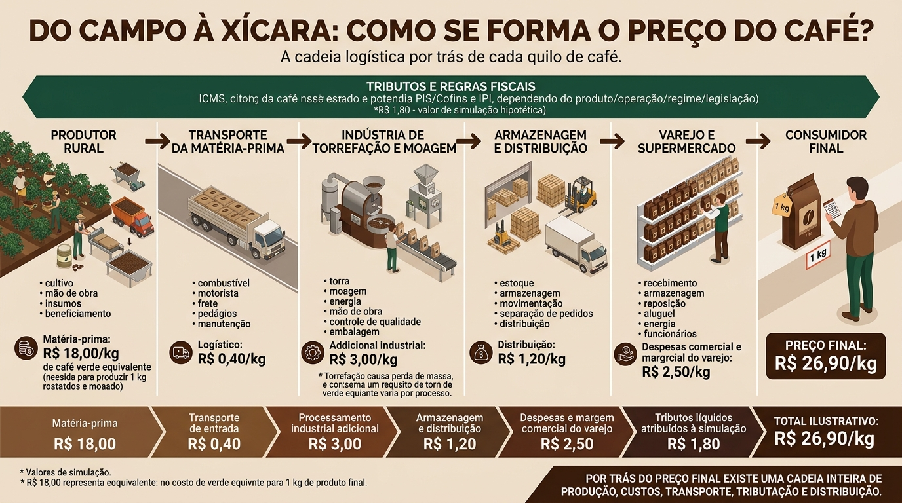

# 📦 Da Origem ao Consumidor: A Cadeia Logística e a Formação de Preços

## 📌 Sobre o projeto

Este projeto tem como objetivo representar visualmente a cadeia logística de um produto, utilizando o café como exemplo, para demonstrar como ele percorre diferentes etapas até chegar ao consumidor final e como os custos envolvidos influenciam a formação do preço de venda.

A proposta é apresentar, de forma simples e didática, a relação entre produção, transporte, processamento industrial, armazenagem, distribuição, varejo e tributação.

O projeto foi desenvolvido com o apoio de ferramentas de Inteligência Artificial, desde a elaboração do prompt até a criação do material visual.

## 🎯 Objetivos

- Compreender as etapas da cadeia de suprimentos, do produtor ao consumidor final.
- Identificar os principais custos envolvidos na cadeia logística.
- Representar a influência dos custos operacionais, logísticos, tributários e comerciais na formação de preços.
- Utilizar Inteligência Artificial como ferramenta de apoio à pesquisa, estruturação e comunicação visual de conceitos logísticos.
- Desenvolver um material educativo que facilite a compreensão do funcionamento da cadeia de suprimentos.

## 🔗 Etapas da cadeia logística

O projeto contempla as seguintes etapas:

1. **Produtor rural:** cultivo, colheita e preparação da matéria-prima.
2. **Transporte de entrada:** movimentação da matéria-prima até a indústria.
3. **Indústria:** processamento, torrefação, moagem e embalagem do café.
4. **Armazenagem e distribuição:** gestão de estoques, movimentação de cargas e transporte.
5. **Varejo:** recebimento, armazenagem, exposição e comercialização do produto.
6. **Consumidor final:** aquisição do produto pelo preço de venda praticado.

Ao longo dessas etapas, são considerados elementos como combustível, frete, mão de obra, energia, armazenagem, embalagens, perdas operacionais, despesas comerciais, tributos e margens dos participantes.

## 🛠️ Ferramentas utilizadas

- **ChatGPT (OpenAI):** apoio na estruturação do projeto, organização das etapas da cadeia logística e elaboração do prompt para geração do material visual.
- **Gemini (Google):** utilização do prompt para gerar a representação visual da cadeia logística e da formação de preços.
- **GitHub:** documentação e publicação do projeto como parte do meu portfólio de aprendizagem.

## 📊 Metodologia

O desenvolvimento foi organizado em quatro etapas:

1. **Definição do problema:** compreender como explicar visualmente a formação do preço de um produto ao longo da cadeia logística.
2. **Estruturação conceitual:** organizar os participantes da cadeia e identificar os principais custos e fatores que influenciam o preço final.
3. **Utilização de Inteligência Artificial:** elaborar um prompt detalhado com o apoio do ChatGPT e utilizá-lo no Gemini para produzir o material visual.
4. **Documentação:** registrar a proposta, as ferramentas utilizadas e os conceitos abordados no GitHub.

## 💰 Formação do preço

O café foi escolhido como produto de referência para ilustrar a evolução do preço desde a matéria-prima até a venda ao consumidor.

O projeto utiliza um preço de referência de **R$ 26,90 por quilograma**, observado no varejo, para contextualizar a proposta.

Os valores intermediários utilizados na simulação são hipotéticos e têm finalidade exclusivamente didática. Eles não representam os custos reais de uma empresa nem uma apuração fiscal efetiva.

A tributação depende da legislação vigente, do produto, da operação e do regime tributário aplicável. Por isso, a simulação não deve ser interpretada como uma composição contábil ou tributária real.

## 📚 Conhecimentos desenvolvidos

- Logística e Supply Chain Management.
- Custos logísticos e operacionais.
- Armazenagem, movimentação e distribuição.
- Formação de preços e cadeia de valor.
- Pensamento analítico e organização de informações.
- Engenharia de prompts e utilização de Inteligência Artificial generativa.
- Comunicação visual de conceitos técnicos.
- Documentação de projetos com Markdown e GitHub.

## 🚀 Aprendizados

Este projeto demonstra como ferramentas de Inteligência Artificial podem apoiar o processo de aprendizagem e a criação de materiais técnicos.

Mais do que gerar uma imagem, o desafio foi estruturar o problema, organizar as etapas da cadeia, identificar os fatores que influenciam o preço e transformar essas informações em uma representação visual de fácil compreensão.

A experiência reforçou a importância de combinar conhecimento técnico, pensamento crítico e tecnologia para desenvolver soluções de comunicação e aprendizagem.

## 👨‍💻 Autor

Profissional com formação em Logística e interesse em Supply Chain, tecnologia e análise de dados aplicada às operações logísticas.

Este projeto faz parte da minha jornada de desenvolvimento profissional, buscando integrar conhecimentos de logística com ferramentas digitais e Inteligência Artificial.

---

**Observação:** material desenvolvido para fins educacionais. Os valores ilustrativos não substituem dados reais de custos, pesquisas de mercado ou análises tributárias.
